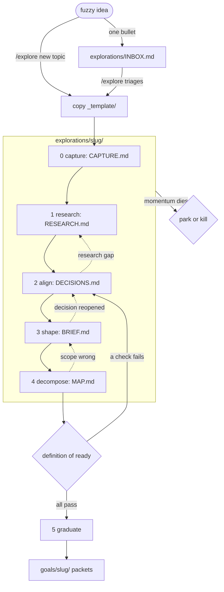

# Explorations

The fuzzy front end: durable packets for brainstorming, research, alignment, shaping and decomposition, the
work that happens before anything is ready to become a `goals/` packet.

`goals/` answers "build this." `explorations/` answers "help me crystallize this." A packet is a docs-as-code
record of a fuzzy idea moving toward graduated goal packets or an explicit park or kill. Nothing here is
doctrine: architecture changes land in `standards/ARCHITECTURE.md` or `CLAUDE.md`, implementation contracts
land in `goals/<slug>/`.

Drive the pipeline with the `/explore` skill ([`.claude/skills/explore/SKILL.md`](../.claude/skills/explore/SKILL.md)).
Adapted from beep-effect (Apache-2.0) without its `beep explore` CLI: the manifest is the only state.

## Read order for cold sessions

1. `INBOX.md` and each `*/ops/manifest.json` (or run `/explore` to list them).
2. The active packet's `README.md`: stage, status, next open question.
3. The packet artifacts for the current stage.

## The pipeline

Six stages. Files beyond `CAPTURE.md` fill in only when their stage begins. Stages may loop: align surfaces a
research gap, shaping reopens a decision. The manifest `stage` is the state; artifact presence is not.



| Stage       | Artifact       | What happens                                                                         | Exit signal                                      |
| ----------- | -------------- | ------------------------------------------------------------------------------------ | ------------------------------------------------ |
| 0 capture   | `CAPTURE.md`   | Append-only raw dump: text, links, screenshots. Never interrogated or reorganized.   | The idea has enough mass to be worth grounding.  |
| 1 research  | `RESEARCH.md`  | Cited prior art and in-repo capability inventory; start `research/SOURCES.md`.       | The landscape and the existing bricks are known. |
| 2 align     | `DECISIONS.md` | Grilling in frontier rounds, recommended answer first. Every resolution is logged.   | Manifest `openQuestions` is empty or deferred.   |
| 3 shape     | `BRIEF.md`     | Shape Up pitch: problem, appetite, fat-marker sketch, rabbit holes, no-gos.          | The human says the brief matches their picture.  |
| 4 decompose | `MAP.md`       | Candidate goal packets, sequencing, dependency edges, first slice, capability cites. | The definition of ready passes.                  |
| 5 graduate  | none           | Scaffold `goals/` packets per the contract below.                                    | Goal packets exist; exploration status flips.    |

## Packet anatomy

```text
explorations/<slug>/
  README.md          orientation: stage, status, next open question, trail
  CAPTURE.md         stage 0, append-only raw dump
  RESEARCH.md        stage 1, cited prior art and capability inventory
  research/SOURCES.md  provenance ledger: sources, licenses, citations, cross-links
  DECISIONS.md       stage 2, dated question, answer, rationale log
  BRIEF.md           stage 3, problem, appetite, sketch, rabbit holes, no-gos
  MAP.md             stage 4, candidate goals, sequencing, first slice
  ops/manifest.json  machine state: stage, status, openQuestions, links
  assets/            screenshots, sketches, captured media
```

New packets start from [`_template/`](./_template/).

## Statuses

| Status      | Meaning                                                                                                  |
| ----------- | -------------------------------------------------------------------------------------------------------- |
| `active`    | Being worked.                                                                                            |
| `parked`    | Shelved with a dated reason in `DECISIONS.md`; revisit later.                                            |
| `graduated` | Spawned its promised-now goal packets; stays as provenance and reopens at `decompose` when a gate fires. |
| `killed`    | Rejected, with a one-line epitaph in `DECISIONS.md` or the README Trail. A successful outcome.           |

## Manifest schema

`ops/manifest.json` is the state the `/explore` skill reads first.

```json
{
  "schemaVersion": "exploration-manifest/v1",
  "exploration": {
    "slug": "<slug>",
    "title": "<Exploration Title>",
    "status": "active",
    "stage": "capture",
    "openQuestions": [],
    "sources": ["research/SOURCES.md"],
    "links": { "goals": [], "supersededBy": null },
    "created": "YYYY-MM-DD",
    "updated": "YYYY-MM-DD"
  }
}
```

- `stage` is one of `capture | research | align | shape | decompose | graduate`.
- `status` is one of `active | parked | graduated | killed`.
- `openQuestions` mirrors the unresolved questions in `DECISIONS.md`; it is the next session's resume point.
- `links.goals` lists graduated `goals/<slug>` packets.

The README Status block mirrors `stage` and `status`; update both together. Check with
`jq . explorations/<slug>/ops/manifest.json`.

## Graduation contract

A packet graduates only when all four hold:

1. **Brief complete**: `BRIEF.md` has a problem narrative, an explicit appetite, a fat-marker solution sketch,
   enumerated rabbit holes and stated no-gos.
2. **No blocking questions**: manifest `openQuestions` is empty, or each item is deferred with rationale in
   `DECISIONS.md`.
3. **Map names the work**: `MAP.md` lists candidate goal packets with slug, mission, dependency edges and the
   chosen first vertical slice.
4. **Capability check**: every major component in `MAP.md` cites an existing slice, driver or app module (by
   package and path) or is marked NET-NEW. Compose the bricks; do not rebuild them.

Per approved candidate:

- Copy `goals/_template` to `goals/<slug>/` and fill it per [`goals/README.md`](../goals/README.md).
- Seed `SPEC.md` from the brief: no-gos become non-goals, rabbit holes become constraints, `DECISIONS.md`
  entries seed the decision log. Back-link the exploration; do not copy it.
- Cross-link both manifests (`links.goals` here, `provenance.exploration` there).
- Once all promised-now goals exist, flip status to `graduated`. Gated candidates stay in `MAP.md` as re-entry
  points; when a gate fires, reopen the exploration at `decompose`.

## Conventions

- `CAPTURE.md` is append-only and excluded from the typos gate (`_typos.toml`): raw dumps stay verbatim.
- Links, not copies: research cites sources; graduation back-links the packet.
- Every session that touches a packet ends by writing the next open question into its `README.md`, syncing
  the manifest and appending a Trail line.
- Needing the operator does not end a session. Align questions, direction calls, shape reviews and
  definition-of-ready gaps go through `/grill-with-docs` until the packet is graduated, parked or killed.
